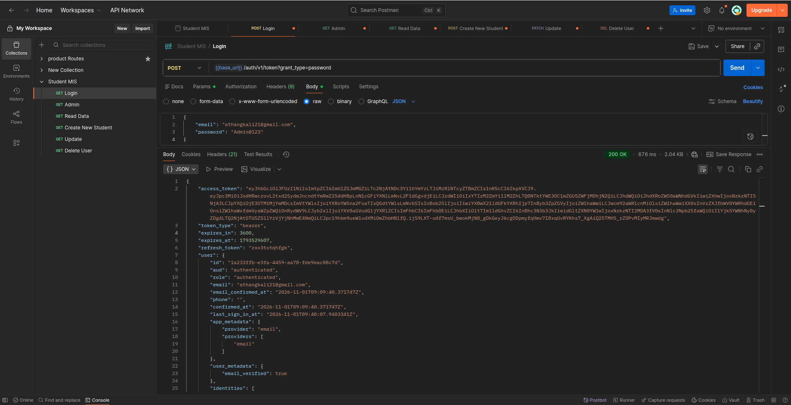
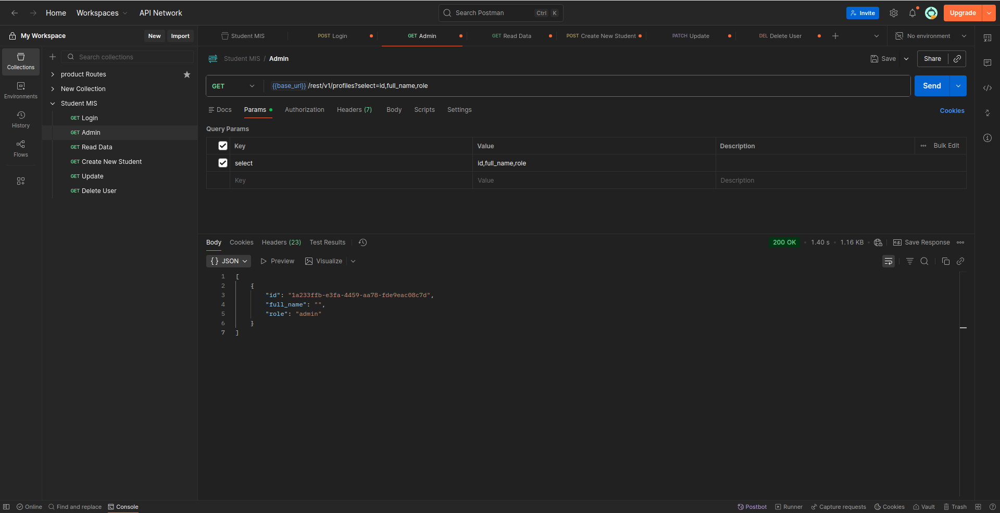
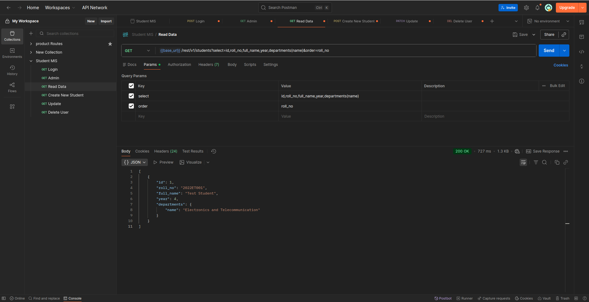
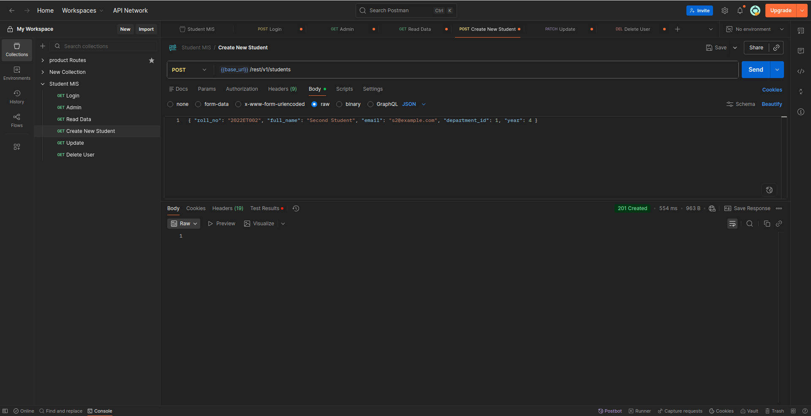
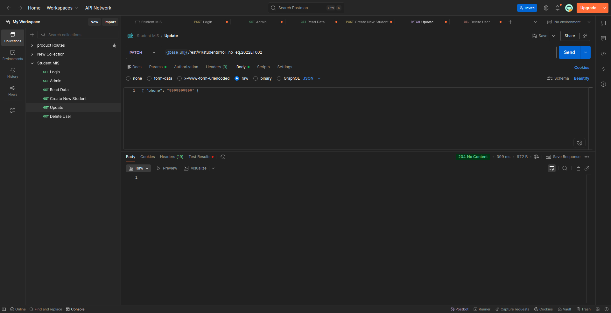
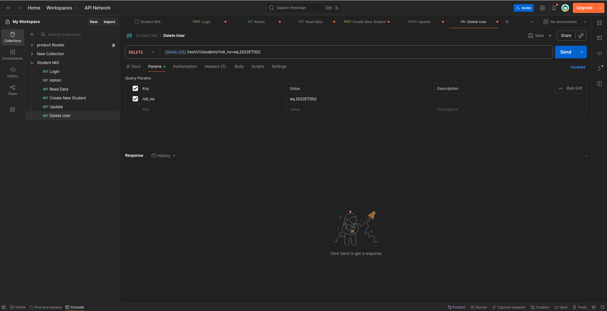

# Student MIS

A role-based Student Management Information System built with React (Vite) and Supabase (Postgres, Auth, Row Level Security).

## Roles

| Role    | Can do                                                                                       |
| ------- | -------------------------------------------------------------------------------------------- |
| Admin   | Everything: students, departments, courses, enrollments, attendance, marks, users and roles  |
| Teacher | View students, courses and enrollments; take attendance and enter marks for assigned courses |
| Student | View own attendance, marks and course summary                                                |

Security is enforced by Row Level Security policies in the database. The UI hides pages by role, but the database is what actually protects the data.

## Setup

1. Create a Supabase project and run the table, trigger and RLS SQL (Steps 3 to 5 of the setup guide).
2. Run `supabase/upgrade.sql` once in the Supabase SQL Editor.
3. Create your first admin user in Authentication > Users, then run:

   ```sql
   update profiles set role = 'admin'
   where id = (select id from auth.users where email = 'you@example.com');
   ```

4. Copy `.env.example` to `.env` and fill in your project URL and publishable (anon) key.
5. Install and run:

   ```bash
   npm install
   npm run dev
   ```

## Using the app

1. Sign in as admin. Add departments, then courses, then students.
2. Create teacher accounts (they sign up on the login page), then open Users and set their role to Teacher. Assign them to courses on the Courses page.
3. Enroll students into courses on the Enrollments page.
4. Teachers take attendance and enter marks.
5. For each student login: the student signs up on the login page, then the admin opens Users and links the account to the student record.

## Deploy (Vercel)

Import the repo, keep the Vite defaults (build `npm run build`, output `dist`), and add `VITE_SUPABASE_URL` and `VITE_SUPABASE_ANON_KEY` as environment variables. `vercel.json` already handles page refreshes for client-side routes. Then add the deployed URL to Supabase Authentication > URL Configuration (Site URL and Redirect URLs).

## Project structure

```
src/
  context/AuthContext.jsx   session and profile (role) state
  components/               Layout, RoleRoute, shared UI
  lib/                      supabase client, helpers, course hook
  pages/                    one file per screen
supabase/upgrade.sql        extra SQL (email column, indexes, optional stricter policies)
```

## Postman Screenshots

- Login 


- Admin


- Read User Data


- Create New Student


- Update Student Data


- Delete User
